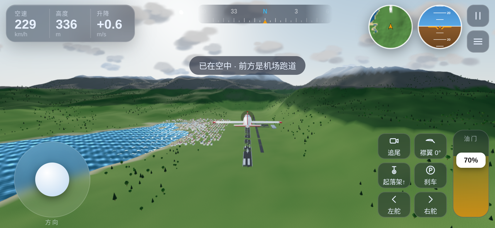

# 云端翱翔 · Three.js 模拟飞行

手机横屏可玩的 3D 模拟飞行（three.js，无需安装）。

**在线试玩：** https://ironadd.github.io/threejs-flight-sim/

- 开始菜单：「空中出发」（300m / 200km/h，推荐）或「跑道起飞」（油门推满约 8 秒自动抬头离地）
- 左摇杆：下拉抬头、上推低头、左右横滚（菜单里可「反转俯仰」）；右侧滑杆：油门
- 按钮：视角、襟翼、起落架、刹车、左/右舵；☰ 菜单：全屏、声音、飞行辅助、重力感应、画质、重置
- 飞行辅助（默认开）：自动改平、高度保持、失速保护、起飞自动抬头
- 键盘：W/S 俯仰，A/D 横滚，Q/E 方向舵，Shift/Ctrl 或 1-0 油门，F 襟翼，G 起落架，B 刹车，C 视角，R/T 重置，P 暂停，M 静音

