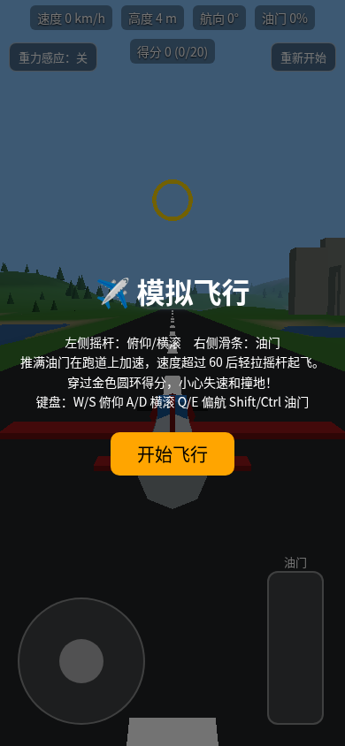

# Three.js 模拟飞行

手机端可玩的 3D 模拟飞行小游戏（单个 HTML 文件，基于 three.js）。

**在线试玩：** https://ironadd.github.io/threejs-flight-sim/

- 左侧摇杆：俯仰/横滚；右侧滑条：油门；可选重力感应
- 键盘：W/S 俯仰，A/D 横滚，Q/E 偏航，Shift/Ctrl 油门
- 跑道起飞（速度 >110 km/h 拉杆）、失速、坠毁重开、穿越金环得分

